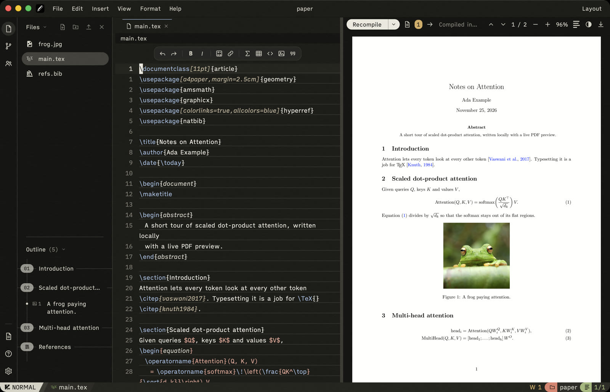
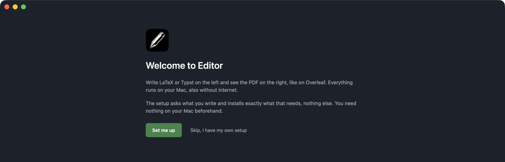

  

<h1 align="center">Editor</h1>

  A native, local alternative to Overleaf for LaTeX, Typst and Markdown. 
  The editor, the compilers and the PDF preview all run on your own computer.

  
  
  
  
  
  
  

  

## Download

| | Download | Guide |
| --- | --- | --- |
| **macOS** 11 or later, Apple silicon and Intel | `Editor-<version>.dmg` from the [latest release](https://github.com/sudo-Oliver/Editor/releases/latest), or `brew install --cask sudo-oliver/tap/editor` | [Editor on macOS](docs/macos.md) |
| **Windows** 10 and 11, 64-bit | `Editor-<version>-windows-x64-setup.exe` from the [latest release](https://github.com/sudo-Oliver/Editor/releases/latest) | [Editor on Windows](docs/windows.md) |

Neither build is signed with a paid certificate yet, so macOS and Windows warn the first time you open it. The guide for your system shows the few clicks past the warning.

## What it does

- **Nothing to install beforehand.** On the first start a short setup asks whether you write LaTeX, Typst or both, and installs exactly that. A test document compiles before it says "all set".
- **Live PDF preview.** Compile on save or while you type. When a build fails, a card names the file and line and explains the error in plain language, and the last good PDF stays visible.
- **Jump between source and PDF** with SyncTeX, follow links and citations inside the PDF, and copy text from it.
- **Writing help without AI or network:** suggestions for commands, environments, labels and citations, a citation picker for `.bib` and Hayagriva files, hints for missing or unused LaTeX packages, a symbol palette, and table and figure inserts.
- **Markdown** with a live preview, typeset formulas and citations. Exports to PDF, Word and HTML through Pandoc.
- **Git and GitHub** in a side panel: stage, commit, branch, pull, push and a history graph. Signing in to GitHub works through the browser.
- **Live sessions and reviews** without a server or an account. Others join with an invite code as editor, reviewer or reader. A reviewer's changes stay suggestions until you accept them.
- **Vim mode**, a focus mode, themes, and updates from inside the app, also for MacTeX.

  

The [user guide](docs/guide.md) describes every part of the editor.

## Built with AI

This project was built with heavy use of AI. Most of the code, the tests and the documentation were written together with AI coding assistants, under human direction and review. It was not programmed by hand alone.

## Contributing

Contributions are welcome: bug reports, ideas and pull requests. Help, Report a problem in the app opens a prefilled GitHub issue. Before you open a pull request, read [CONTRIBUTING.md](CONTRIBUTING.md). It explains how to build the app, the rules for the repository, and the terms for contributions.

## License

Editor is source-available under the [PolyForm Strict License 1.0.0](LICENSE). You may use it for any noncommercial purpose. You may not sell it, use it commercially, distribute it, or build your own editor or other works from its code. Contributions through pull requests to this repository are welcome under the terms in [CONTRIBUTING.md](CONTRIBUTING.md). For any other use, ask the author through a GitHub issue.
